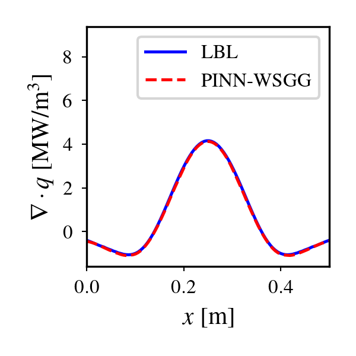

# PINN-WSGG-Python

> A Python program implementing a pressure-dependent Physics-Informed Neural Network (PINN) based Weighted Sum of Gray Gases (WSGG) model for radiative heat transfer in H<sub>2</sub>O-CO<sub>2</sub>-CO participating-gas mixtures.

---

## Overview

This repository provides a Python implementation of a pressure-dependent PINN-WSGG model for accurate and efficient prediction of radiative properties in H<sub>2</sub>O-CO<sub>2</sub>-CO gas mixtures. The program includes trained model parameters, a 1D radiative transfer equation solver, and a test script for comparison against Line-by-Line (LBL) benchmark data.

**Key features:**

* Python-based pressure-dependent PINN-WSGG model for H<sub>2</sub>O / CO<sub>2</sub> / CO gas mixtures
* Pressure support range from 0.1 to 80 bar
* 1D Radiative Transfer Equation (RTE) solver
* Validation against Line-by-Line (LBL) benchmark data
* Automated generation of comparison figures

---

## Installation and Usage

1. Enter the package directory:

```bash
cd ./PINN-WSGG_Python
```

2. Install the required dependencies:

```bash
pip install -r requirements.txt
```

3. Run the test script:

```bash
python test.py
```

The script performs the following steps:

* Loads the PINN-WSGG model parameters from `PINN_WSGG/data/wsgg.json`
* Loads test profiles from `data/profiles.npy`
* Loads LBL reference results from `data/results.npy`
* Solves the 1D RTE using the pressure-dependent PINN-WSGG model
* Compares the predicted volumetric radiative heat loss with the LBL result
* Exports the figure as `test_case.png`

---

## Output



---

## Repository Structure

```text
PINN-WSGG_Python/
├── data/
│   ├── profiles.npy          # Thermochemical solution profiles
│   └── results.npy           # LBL benchmark reference results
├── PINN_WSGG/
│   ├── __init__.py
│   ├── mlp.py                # Multi-layer perceptron architecture
│   ├── nn_wsgg.py            # Neural-network WSGG model and RTE wrapper
│   ├── plot_setup.py         # Plotting configuration
│   ├── rte.py                # Radiative transfer equation solver
│   └── data/
│       └── wsgg.json         # Trained model parameters
├── test.py                   # Test script
├── test_case.png             # Example output figure
├── requirements.txt          # Python dependencies
├── README.md                 # This document
├── LICENSE                   # License information
└── .gitignore
```

---

## License

This project is made publicly available under the custom
**PINN-WSGG Academic Research and Non-Commercial License v1.0**. It is not
released under an OSI-approved open-source license. Academic and other
non-commercial use is permitted. Commercial use requires prior written
permission from the authors. See the [`LICENSE`](LICENSE) file for details.
